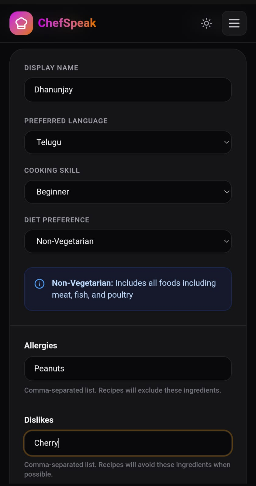

<div align="center">

# 🍳 ChefSpeak

### Less scrolling. More cooking.

A recipe that speaks your language. A meal made from what you have.

[Start cooking →](https://chefspeak.vercel.app) · [Report an issue](https://github.com/dhanunjay1729/chefspeak-2.0/issues)

</div>

<table align="center">
  <tr>
    <th align="center">🔊 Cook, step by step</th>
    <th align="center">🥕 Use what you have</th>
    <th align="center">⏯️ Pick up where you left off</th>
  </tr>
  <tr>
    <td width="33%" align="center" valign="top"></td>
    <td width="33%" align="center" valign="top"></td>
    <td width="33%" align="center" valign="top"></td>
  </tr>
</table>

<p align="center"><sub>ChefSpeak on a phone · Actual app screenshots at 375 × 812</sub></p>

## ✨ From an idea to a meal

**🤖 Your idea, a complete recipe.** Name a dish, choose your servings, and add your notes. Get ingredients and cooking steps shaped by your preferences and skill level.

**🔊 Listen. Cook. Repeat.** Hear each step in your preferred language, replay it when you need to, and start a timer right from the instructions. Check off ingredients as you prep.

**🥕 A little pantry inspiration.** Add your ingredients and staples. Discover dishes with cooking times and a clear list of what you have, what is missing, and what is optional.

## 🎛️ Make it your kitchen

<table>
  <tr>
    <td width="40%" align="center" valign="top">
      
    </td>
    <td valign="top">
      <h3>Your taste. Your pace. Your language.</h3>
      <p>Personalize the guidance before you start cooking.</p>
      <p><strong>🌍 Speak your language</strong><br />Choose the language for recipes and voice guidance.</p>
      <p><strong>🧑‍🍳 Cook at your level</strong><br />Set your experience, from beginner to pro.</p>
      <p><strong>🥗 Choose your diet</strong><br />Vegetarian, vegan, or non-vegetarian.</p>
      <p><strong>🎛️ Fine-tune your ingredients</strong><br />Add allergies and dislikes to guide recipe generation. Always check generated ingredients before cooking.</p>
      <p><sub>Phone settings screenshot provided by the creator, shown in dark mode.</sub></p>
    </td>
  </tr>
</table>

- **Favorites and discovery:** Sign in to save dishes, revisit recipe history, and get recommendations based on your favorites.
- **Continue cooking:** Resume a recipe on the same device with your current step, checked ingredients, and timer deadlines preserved.
- **Cooking notes:** Remember your adjustments for next time, with account notes saved with recipes and guest notes kept on the device.
- **Nutrition at a glance:** View estimated calories, protein, fat, and carbohydrates per serving.
- **Light and dark themes:** Choose the appearance that suits your kitchen.

Recipes, suggestions, and nutrition are AI-generated. Check ingredients against your dietary needs; nutrition values are estimates. Timer alerts depend on the browser remaining active.

## 🛠️ Built with

| Layer | Technology |
| --- | --- |
| Interface | React · Vite · Tailwind CSS · Framer Motion |
| Recipe intelligence | OpenAI GPT-6 Luna via Vercel AI Gateway; optional Gemini mode |
| Voice | Google Cloud Text-to-Speech |
| Accounts and saved recipes | Firebase Authentication · Firestore |
| API | Node.js · Express |
| Hosting | Vercel · Render |

## 📱 Android and iOS projects

The `android/` and `ios/` folders use Capacitor to package this React app. They share the recipe screens and hosted API with the website. The native app ID is `com.dhanunjay1729.chefspeak` on both platforms.

1. Install Node.js 22+, then run `npm ci` in the repository root.
2. Create an ignored `.env.local` from `.env.example` and fill in the existing Firebase **web** app values. Mobile builds require these values at build time. Optionally set `VITE_MOBILE_API_BASE_URL`; it defaults to `https://chefspeak-api.onrender.com` and should use HTTPS.
3. Run `npm run mobile:sync` after each web code change. This builds the web bundle and copies it into both native projects.
4. For an Android debug APK, install JDK 21 and Android SDK Platform 36, then run `cd android && ./gradlew assembleDebug`. The APK is written to `android/app/build/outputs/apk/debug/app-debug.apk`. Android Studio can also build and test the project.
5. Open `ios/App/App.xcodeproj` in Xcode on a Mac to build and test iOS. A Mac is required for the iOS build.

The native apps are registered in Firebase project `chefspeak-599e8`. Their config files are ignored by Git. On a fresh checkout, a signed-in Firebase CLI can restore them:

```sh
firebase apps:sdkconfig android 1:432936353340:android:8307e84b604edd4f05cd39 --project chefspeak-599e8 --out android/app/google-services.json
firebase apps:sdkconfig ios 1:432936353340:ios:29d2af21248e1c0f05cd39 --project chefspeak-599e8 --out ios/App/App/GoogleService-Info.plist
```

The iOS project includes the plist in its target and has its Google callback URL scheme. For Android Google sign-in, add the debug and eventual release signing certificate SHA-1 fingerprints to the Android app in Firebase, then download the updated `google-services.json`. Test sign-in on devices. [Android setup](https://firebase.google.com/docs/auth/android/google-signin) · [iOS setup](https://firebase.google.com/docs/auth/ios/google-signin)

Cooking timers schedule local device alerts on mobile. Notification and exact-alarm permissions can affect delivery; verify them on the target devices. The browser-based voice command components are not used in the active cooking screens. Native voice commands still need device testing, while spoken step playback remains available.

## 🤝 Contributing

Have an idea or found a bug? [Open an issue](https://github.com/dhanunjay1729/chefspeak-2.0/issues) or send a pull request. For code changes, run `npm test` and `npm run build` before submitting.

## 📄 License

[CC BY-NC-SA 4.0](LICENSE) — attribution required, non-commercial use only, and adaptations must use the same license.

---

<p align="center">
  Built by <a href="https://github.com/dhanunjay1729">Dhanunjay</a> · <a href="mailto:pantadhanunjay@gmail.com">Get in touch</a>
</p>
