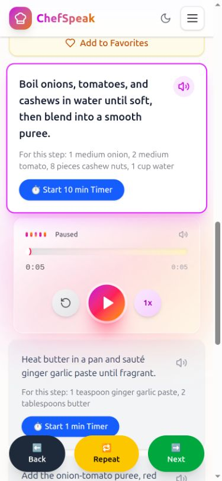
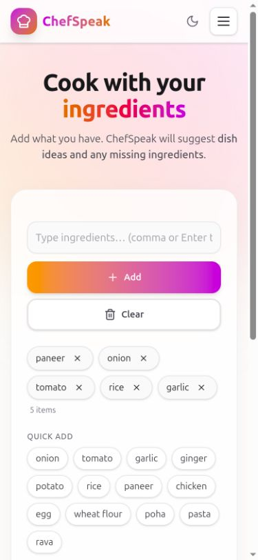
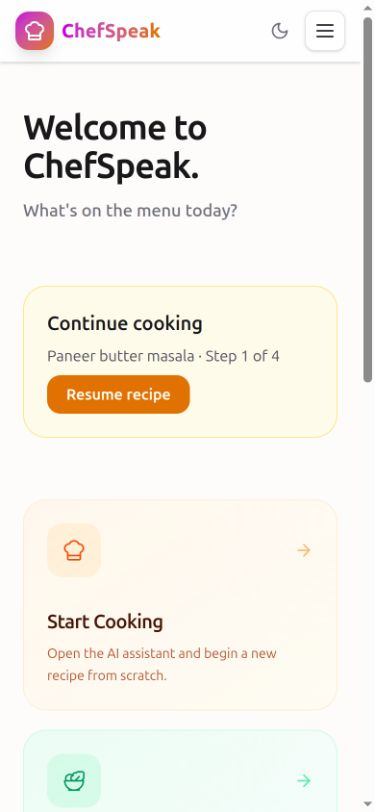

# ChefSpeak

### Your cooking companion, one step at a time.

AI recipes, voice guidance, and meal ideas from the ingredients you already have.

[Try ChefSpeak](https://chefspeak.vercel.app) · [Report an issue](https://github.com/dhanunjay1729/chefspeak-2.0/issues)

<table align="center">
  <tr>
    <th align="center">Cook, step by step</th>
    <th align="center">Use what you have</th>
    <th align="center">Pick up where you left off</th>
  </tr>
  <tr>
    <td width="33%" align="center" valign="top"></td>
    <td width="33%" align="center" valign="top"></td>
    <td width="33%" align="center" valign="top"></td>
  </tr>
</table>

ChefSpeak on a phone · Actual app screenshots at 375 × 812

## From an idea to a meal

**Find your next dish.** Enter a dish name, choose your servings, and add a few notes. ChefSpeak generates ingredients and step-by-step instructions, taking your saved dietary preferences and cooking experience into account.

**Keep your hands on the cooking.** Listen to instructions in your preferred language, repeat a step, and start timers directly from the recipe. Ingredient checklists help you keep track as you prepare.

**Use what you have.** Add ingredients and confirm your pantry staples. Get dish suggestions showing what you can use, what is missing, optional extras, and estimated cooking time.

## Make it your kitchen

- **Personal preferences:** Set your language, dietary type, allergies, ingredient dislikes, and skill level.
- **Favorites and discovery:** Sign in to save dishes, revisit recipe history, and get recommendations based on your favorites.
- **Continue cooking:** Resume a recipe on the same device with your current step, checked ingredients, and timer deadlines preserved.
- **Cooking notes:** Remember your adjustments for next time, with account notes saved with recipes and guest notes kept on the device.
- **Nutrition at a glance:** View estimated calories, protein, fat, and carbohydrates per serving.
- **Light and dark themes:** Choose the appearance that suits your kitchen.

Recipes, suggestions, and nutrition are AI-generated. Check ingredients against your dietary needs; nutrition values are estimates. Timer alerts depend on the browser remaining active.

## Built with

| Layer | Technology |
| --- | --- |
| Interface | React · Vite · Tailwind CSS · Framer Motion |
| Recipe intelligence | Google Gemini |
| Voice | Google Cloud Text-to-Speech |
| Accounts and saved recipes | Firebase Authentication · Firestore |
| API | Node.js · Express |
| Hosting | Vercel · Render |

## Contributing

Have an idea or found a bug? [Open an issue](https://github.com/dhanunjay1729/chefspeak-2.0/issues) or send a pull request. For code changes, run `npm test` and `npm run build` before submitting.

## License

[CC BY-NC-SA 4.0](LICENSE) — attribution required, non-commercial use only, and adaptations must use the same license.

---

  Built by <a href="https://github.com/dhanunjay1729">Dhanunjay</a> · <a href="mailto:pantadhanunjay@gmail.com">Get in touch</a>

